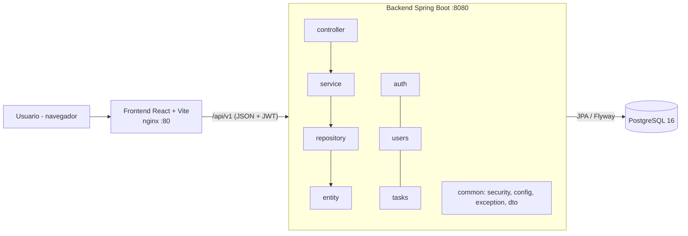

# Arquitectura — Task Manager

## Estilo

**Monolito modular en capas.** Un único backend desplegable dividido en módulos de negocio (`auth`, `users`, `tasks`) y un
módulo transversal (`common`). Cada módulo usa las mismas capas: `controller`, `service`, `repository`, `entity` y `dto`.

## Diagrama de componentes



## Módulos

| Módulo | Responsabilidad | Depende de |
|---|---|---|
| `common` | Seguridad (JWT, filtro, BCrypt, CORS), configuración, excepciones y DTO compartidos | — |
| `users` | Entidad `User`, rol, listado para `ADMIN`, usuario administrador inicial | `common` |
| `auth` | Registro e inicio de sesión | `common`, `users.service` |
| `tasks` | Entidad `Task`, CRUD, cambio de estado, reprogramación, listado y calendario | `common` |

Las reglas de dependencia entre módulos se verifican automáticamente con una prueba ArchUnit (`ArchitectureTest`).

## Justificación de decisiones

| Decisión | Alternativa descartada | Motivo |
|---|---|---|
| Monolito modular | Microservicios | Dos entidades y un equipo de tres personas: un solo despliegue reduce complejidad y facilita medir el código completo. |
| Capas controller/service/repository | Arquitectura hexagonal | Menos clases e indirecciones; las métricas CK reflejan directamente el diseño. |
| JWT sin estado + BCrypt | Sesiones en servidor | El frontend es una SPA independiente; BCrypt es el estándar para contraseñas. |
| PostgreSQL + Flyway | Esquema generado por JPA | Migraciones versionadas y reproducibles. |
| Docker Compose | Instalación manual | Cualquier integrante o evaluador levanta el sistema con un comando. |

## Estructura de carpetas

```
task-manager-metricas/
├── README.md
├── .gitignore
├── docker-compose.yml
├── .env.example
├── docs/
│   ├── informe-final.pdf
│   ├── requisitos.md
│   ├── trazabilidad.md
│   ├── arquitectura/
│   └── metricas/
├── src/
│   ├── backend/      # Spring Boot: common, auth, users, tasks
│   └── frontend/     # React: pages, components, services, routes
├── tests/            # colección Postman
└── metricas/         # script y configuración de medición
```
